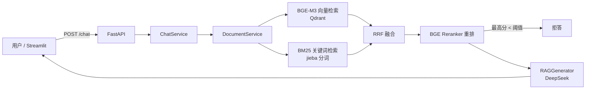

# Enterprise RAG Assistant

企业知识库问答系统。使用**向量 + BM25 混合检索**、**RRF 融合**和 **Reranker 重排序**召回资料，由大模型基于资料生成带引用编号的答案；资料不足时拒答。

## 架构



| 环节 | 实现 |
|---|---|
| 文档加载 | md / txt / html / pdf（保留页码）/ docx（含表格） |
| 切分 | 按 Markdown 标题分章节；代码块、表格保持完整；超长段落按句子切分并带重叠 |
| 向量化 | `BAAI/bge-m3`，1024 维，归一化 |
| 向量库 | Qdrant 本地持久化模式，余弦距离 |
| 关键词检索 | `rank_bm25` + jieba，中英文混合分词 |
| 融合 | RRF（k=60） |
| 重排序 | `BAAI/bge-reranker-v2-m3` |
| 生成 | DeepSeek（OpenAI 兼容接口），提示词要求引用编号、资料冲突时指出冲突、不执行资料中的指令 |
| 拒答 | 最高 rerank 分数低于阈值（默认 0.2，需要用评测集校准） |
| 文档管理 | 上传（SHA-256 内容去重）、列表、删除（同步清理向量、BM25 索引、磁盘文件） |

## 目录结构

```
backend/
├── main.py                 应用入口，只负责组装
├── api/                    chat.py、documents.py
├── core/                   config.py（全部配置）、llm.py、exceptions.py
├── rag/                    loader / splitter / embedding / vector_store / retriever / reranker / generator
├── services/               chat_service.py、document_service.py
└── schemas/                请求和响应模型
frontend/app.py             Streamlit 界面
scripts/                    ingest.py、export_chunks.py、check_eval_set.py、evaluate.py
tests/                      pytest，使用假 Embedding/向量库，不需要模型和 API Key
data/
├── enterprise/             知识库文档（放这里）
├── metadata/sources.json   可选：文档来源登记表
├── uploads/                上传的文档（自动生成）
├── qdrant_storage/         向量库（自动生成）
└── evaluation/             评测集和评测结果
```

## 快速开始

需要 Python 3.11。

```powershell
python -m venv .venv
.\.venv\Scripts\Activate.ps1
pip install -r requirements.txt -r requirements-frontend.txt

copy .env.example .env      # 然后填入 DEEPSEEK_API_KEY
```

把知识库文档放进 `data/enterprise/`，然后启动后端（在项目根目录执行）：

```powershell
uvicorn backend.main:app --reload
```

首次启动会下载模型（BGE-M3 和 Reranker 合计约 4–5 GB），并给知识库生成向量，需要几分钟。看到“启动成功”后：

- 接口文档：http://127.0.0.1:8000/docs
- 前端：另开一个终端执行 `streamlit run frontend/app.py`，访问 http://localhost:8501

> **注意**：Qdrant 本地模式是文件锁，同一时间只能有一个进程打开向量库。运行 `scripts/` 下的脚本前先停掉 uvicorn，也不要使用多个 worker。

### 离线建库

```powershell
python -m scripts.ingest              # 只补写向量库里缺失的 Chunk
python -m scripts.ingest --rebuild    # 清空后全部重建（修改切分逻辑或更换模型后使用）
```

## API

| 方法 | 路径 | 说明 |
|---|---|---|
| GET | `/health` | 服务状态 |
| POST | `/chat` | 问答，body：`{"query": "...", "top_k": 3}` |
| POST | `/documents/upload` | 上传 PDF / DOCX / TXT / MD（≤ 10 MB），multipart 字段名 `file` |
| GET | `/documents` | 文档列表 |
| DELETE | `/documents/{upload_id}` | 删除上传的文档 |

```powershell
curl.exe -X POST http://127.0.0.1:8000/chat -H "Content-Type: application/json" `
  -d '{\"query\": \"研发环境需要安装什么 Python 版本？\", \"top_k\": 3}'

curl.exe -F "file=@C:\path\to\手册.pdf" http://127.0.0.1:8000/documents/upload
```

状态码：`400` 参数或文件无效，`409` 重复文件，`413` 文件过大，`422` 文件无法解析（如扫描版 PDF），`404` 文档不存在，`502` 大模型服务故障，`503` 系统尚未初始化。

## 评测

评测只针对检索环节，不调用大模型，不产生 API 费用。

```powershell
python -m scripts.export_chunks                      # 导出 Chunk 清单，用来编写评测集
python -m scripts.check_eval_set                     # 检查评测集的证据句仍能在清单里找到
python -m scripts.evaluate --sample 12               # 先抽样试跑
python -m scripts.evaluate                           # 完整评测
```

评测集 `data/evaluation/eval_set.jsonl`，每行一题：

```json
{"id": "E001-1", "question": "...", "answerable": true, "gold_snippets": ["3.11.x"], "reference_answer": "..."}
{"id": "N-7", "question": "...", "answerable": false, "negative_type": "near_miss"}
```

命中规则：检索到的 Chunk 正文包含任一 `gold_snippets`，或 Chunk ID 在 `gold_chunk_ids` 中。推荐使用 `gold_snippets`，因为重新切分后 Chunk ID 会变。

输出包括：

1. 向量 / BM25 / RRF / RRF + Reranker 四种方案的 Hit@1/3/5 和 MRR（消融对比）；
2. 拒答阈值扫描：可回答题仍作答的比例，以及不可回答题（分 `off_topic` 和 `near_miss`）被正确拒答的比例。

### 评测结果

评测题数：可回答 74，不可回答 14    DeepseekV4Flash   
检索效果（只统计可回答的题）

| 方案 | Hit@1 | Hit@3 | Hit@5 | MRR |
|---|---|---|---|---|
| 向量检索 | 64.9% | 79.7% | 85.1% | 0.735 |
| BM25 | 82.4% | 93.2% | 95.9% | 0.883 |
| RRF 混合 | 79.7% | 87.8% | 93.2% | 0.856 |
| 混合 + Reranker | 94.6% | 97.3% | 100.0% | 0.966 |

拒答阈值扫描（最高 rerank 分数 < 阈值就拒答）

| 阈值 | 可回答题仍作答 | 不可回答题正确拒答 |
|---|---|---|
| 0.05 | 100.0% | 57.1% |
| 0.1 | 100.0% | 71.4% |
| 0.2 | 100.0% | 92.9% |
| 0.3 | 98.6% | 92.9% |
| 0.4 | 97.3% | 92.9% |
| 0.5 | 95.9% | 92.9% |

不可回答题按类型的正确拒答率

| 类型 | 0.05 | 0.1 | 0.2 | 0.3 | 0.4 | 0.5 |
|---|---|---|---|---|---|---|
| off_topic | 83.3% | 83.3% | 100.0% | 100.0% | 100.0% | 100.0% |
| near_miss | 37.5% | 62.5% | 87.5% | 87.5% | 87.5% | 87.5% |
## Docker

```powershell
copy .env.example .env      # 填入 DEEPSEEK_API_KEY
docker compose up --build
```

- 后端 http://localhost:8000，前端 http://localhost:8501
- `./data` 挂载到容器，知识库文档、上传文件和向量库不会随容器丢失
- 模型缓存在 `hf_cache` 卷里，首次启动下载完成后不再重复下载
- 后端镜像默认安装 CPU 版 PyTorch；前端镜像只有 Streamlit，体积很小

## 测试

```powershell
pip install -r requirements-dev.txt
pytest
```

测试使用假的 Embedding、向量库和 Reranker，不加载模型、不联网，覆盖切分、检索融合、问答流程、上传去重与删除、HTTP 状态码映射等。

## 设计说明

- **混合检索**：向量检索擅长语义，BM25 擅长版本号、命令、错误码这类精确匹配，RRF 只用排名融合，不需要对齐两种分数的量纲。
- **要 Reranker**：召回阶段取较多候选，再用交叉编码器精排，只把最相关的少量片段交给大模型，减少上下文噪声。
- **启动时增量同步**：按 Chunk ID 与向量库比对，只给缺失的 Chunk 生成向量；修改了已有文档的内容后需要 `--rebuild`。
- **上传的文档 ID** 为 `upload:<upload_id>`，同名文件不会互相覆盖。
- **并发**：耗时的解析和向量化在锁外执行，写向量库、替换 BM25 索引和检索本身在同一把锁内。

## 已知限制
- 没有认证和权限控制，也没有多租户隔离；若用于真实环境需要先补上。
- 不支持对话历史，每次提问相互独立。
- 扫描版 PDF 需要先做 OCR，目前返回 422。
- 单进程部署（Qdrant 本地模式限制）；需要横向扩展时应改用 Qdrant 服务端。
- 拒答阈值是单一的重排分数阈值，对“话题相关但资料里没有”的问题效果有限，见评测中的 `near_miss` 统计。
